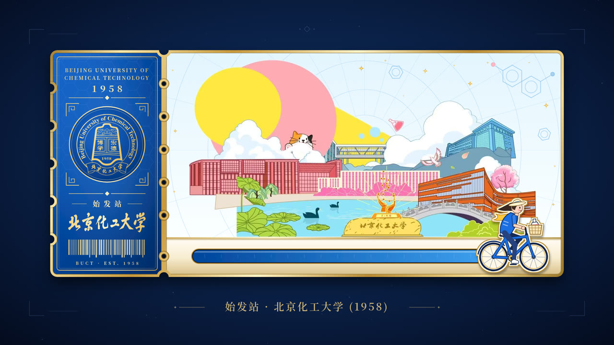

# 北京化工大学 · 门票动画

在线体验：[uscfty.github.io/buct-ticket](https://uscfty.github.io/buct-ticket/)

一张横版“门票”动画页面：左侧蓝色票根（校徽、中英文校名、1958），右侧校园插画随骑车小人依次出现，小人沿底部滑轨从左骑到右。页面会自动播放一遍，也可以用手指或鼠标拖动小人/滑轨来回查看。



成片视频：[`assets/video/buct-ticket.mp4`](./assets/video/buct-ticket.mp4)（1920×1080，6 秒，30 帧/秒）

## 本地启动

需要 Node.js 18 或更高版本。

```bash
npm install
npm run dev -- --host
```

终端会打印两个地址：

- `Local: http://localhost:5173/` —— 本机浏览器打开
- `Network: http://<电脑的局域网 IP>:5173/` —— 手机和电脑连同一个 Wi-Fi 后，用 iPhone 的 Safari 打开这个地址即可真机查看

打包静态文件：

```bash
npm run build      # 输出到 dist/，全部是相对路径，可直接放到任意静态服务器或 GitHub Pages
npm run preview    # 本地预览 dist/
```

## GitHub Pages 发布

本项目通过 `.github/workflows/deploy.yml` 自动发布。推送到 `main` 后，GitHub Actions 会安装锁定的依赖、构建页面，并将 `dist/` 部署到 GitHub Pages。

网站地址：<https://uscfty.github.io/buct-ticket/>。部署结果可在仓库的 **Actions** 页面查看；仓库的 **Settings → Pages → Source** 应设为 **GitHub Actions**。

后续更新：在本项目目录修改、提交并推送到 `main`，即可自动更新线上页面。

## 目录结构

```
.
├── index.html            页面与 SVG 骨架（渐变、蒙版、滤镜、票面结构）
├── src/
│   ├── main.js           动画时间轴、骑车小人、播放与拖动逻辑
│   └── style.css         页面样式、字体声明、触控相关 CSS
├── assets/               所有静态资源都在这里，页面不引用任何外链
│   ├── layers/           校园插画拆出的 21 个图层 PNG + meta.json（位置信息）
│   ├── logo/             北化官方横版校标 SVG（蓝色版用于票根，标准色版备用）
│   ├── fonts/            思源宋体子集（只含页面用到的字，约 19 KB/个）+ OFL 授权文本
│   ├── images/           校园插画原图、预览图
│   └── video/            导出的 MP4 成片
├── tools/                可选的 Python 辅助脚本（运行页面不需要）
│   ├── segment_layers.py 从插画原图重新生成 assets/layers
│   ├── render.py         逐帧截图并合成 MP4
│   └── check_touch.py    触控自检
├── vite.config.js
└── package.json
```

资源引用方式：

- 图层 PNG、校标 SVG、meta.json 在 `src/main.js` 里用相对路径 `../assets/...` 引入；
- 字体在 `src/style.css` 里用 `@font-face` 引入 `../assets/fonts/...`；
- `npm run build` 时 Vite 会把用到的资源复制到 `dist/assets/`。

## 交互

- 打开后自动播放一遍并停在结尾。
- 按住小人或滑轨左右拖动，画面随小人位置前进/后退；松手停在原地，拖到最右端会接着播完片尾。
- “重播”按钮从头再播。

## iOS Safari 触控处理

目标：手指在滑轨上拖动时，页面不能跟着上下滚动；在票面其他位置滑动时，页面照常滚动。

做法（`src/main.js`、`src/style.css`）：

1. 滑轨上盖了一块透明热区 `#railHit`，只有它拦截手势。
2. 热区设置 `touch-action: none`（iOS 13 及以上生效）。
3. 在热区**元素本身**上用 `{ passive: false }` 注册 `touchstart` / `touchmove` 并调用 `preventDefault()`。  
   iOS Safari 把 `document` / `window` 上的触摸监听默认当作 passive，在那里调用 `preventDefault()` 无效；并且页面一旦开始滚动，后面的 `touchmove` 就不能再取消，所以要从 `touchstart` 就拦。
4. 拖动用 Pointer Events + `setPointerCapture`，手指滑出热区也不会断；没有 Pointer Events 的旧系统（iOS 12 及更早）自动退回 Touch Events。
5. 画面设置 `-webkit-user-select: none`、`-webkit-touch-callout: none`，长按不会弹出选择框或系统菜单。
6. 票面阴影滤镜只作用在静态票形上，不随动画逐帧重算，减轻手机上的渲染负担。

自检脚本（需要先 `npm run dev`）：

```bash
pip install playwright && playwright install chromium webkit
python3 tools/check_touch.py
```

它用 Chromium 的 iPhone 模拟发真实触摸手势检查 `scrollY`，并在 WebKit（Safari 的内核）里检查事件拦截和拖动逻辑，横屏竖屏各跑一遍。注意这是桌面上的模拟，**不等同于 iPhone 真机**，上线前请用真机按上面的 Network 地址再滑一次。

## 重新生成素材（可选）

```bash
pip install pillow numpy scipy playwright && playwright install chromium
python3 tools/segment_layers.py   # 换了插画原图后，重新拆图层（脚本里的区域坐标是按当前这张图标的）
python3 tools/render.py           # 需要先 npm run dev；逐帧截图并用 ffmpeg 合成 assets/video/buct-ticket.mp4
```

## 素材与授权

- 校徽、校名：北京化工大学官方 VI 矢量文件（`assets/logo/`），校标的使用请遵循学校的 VI 规范。
- 校园插画：由项目发起人提供（`assets/images/campus-illustration.jpg`）。
- 字体：Noto Serif CJK SC（思源宋体）子集，SIL Open Font License 1.1，授权文本见 `assets/fonts/OFL.txt`。
